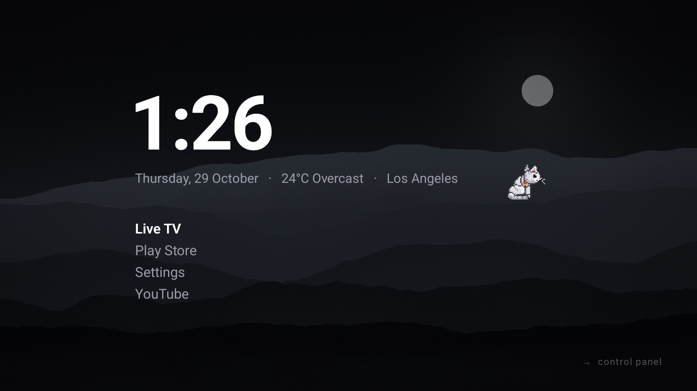
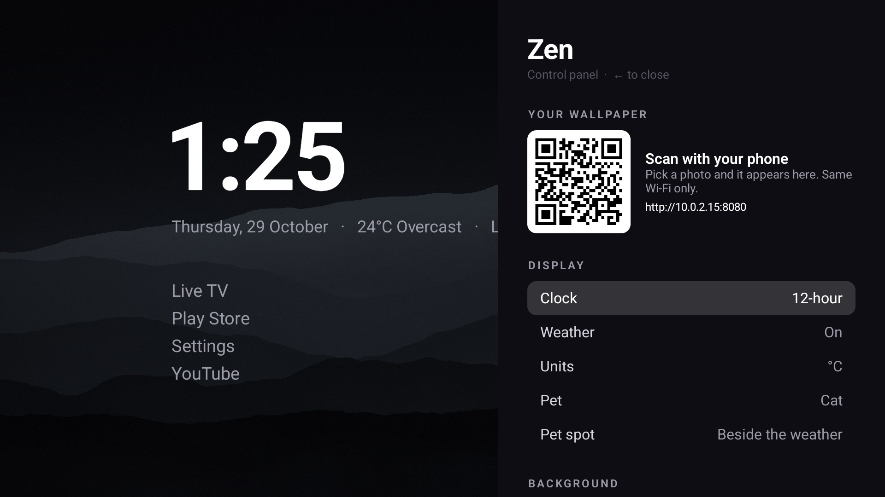
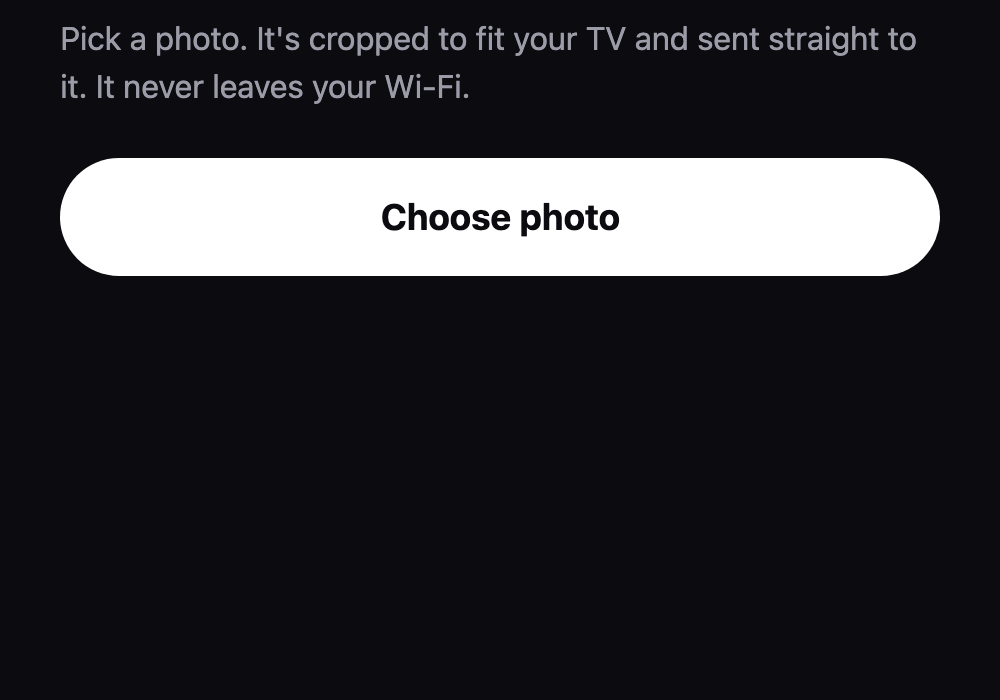
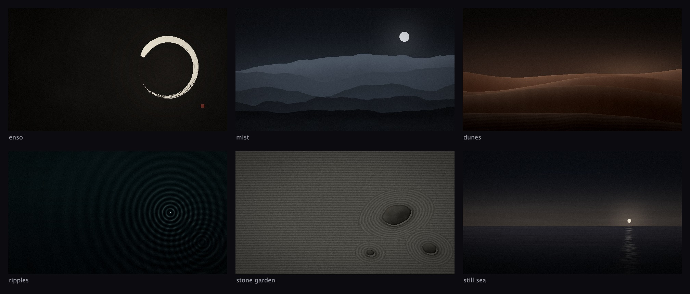
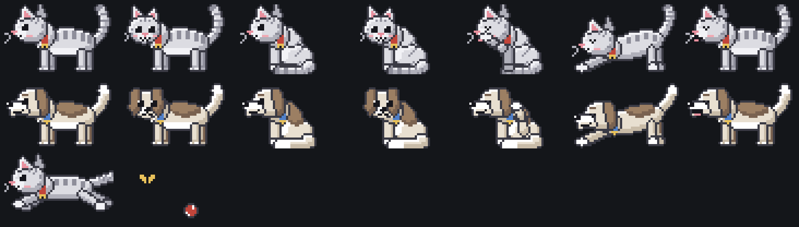

# Zen

A calm, text-only home screen for Google TV and Android TV, inspired by minimal phone launchers.



A big clock, your handful of apps, the weather, and nothing flashing at you. Add your own wallpaper by
scanning a QR code with your phone, and keep a tiny 8-bit cat or dog company in the corner.

## Features

- **Huge clock + date + weather.** No account, no API key. Celsius or Fahrenheit.
- **Text-only app list.** Up/down to move, OK to open, **hold OK to hide** an app you never use.
- **OLED-friendly black**, or one of six built-in wallpapers, or your own photos.
- **Wallpaper from your phone.** Press → for the control panel, scan the QR code, pick a photo. It is
  cropped on your phone and sent straight to the TV over your Wi-Fi.
- **A little pet** (cat, dog or off) that strolls, sits, grooms, stretches, yawns, plays with a butterfly
  or ball, looks at you when it's done, watches the app list while you browse, and naps when you're away.
  Choose where it lives: beside the weather, by the clock, or along the bottom.
- **Control panel** (press → on the home screen): clock format, weather, show or hide your city, units, pet,
  pet spot, wallpaper, dim level, and show/hide for every app.

| Control panel | Your wallpaper, from your phone | Built-in wallpapers |
|---|---|---|
|  |  |  |



## Install

You need a computer with [`adb`](https://developer.android.com/tools/releases/platform-tools) and a TV with
**developer options → network debugging** (or USB debugging) turned on.

```bash
./install-tv.sh 192.168.1.40     # your TV's IP address
```

The script builds Zen, installs it and makes it the home screen. Most TVs ship a launcher that outranks any
home app you pick, so the script **asks before turning that launcher off** for your user (nothing is
uninstalled). To go back at any time:

```bash
./install-tv.sh --restore 192.168.1.40
```

Requires Android TV / Google TV 9 or newer.

## Privacy

Zen has no analytics, no accounts and no ads. It makes exactly these network requests:

| What | Where | Why |
|---|---|---|
| Your approximate location, from your IP address | [ipwho.is](https://ipwho.is) | to know which city's weather to show |
| Current temperature and conditions for that location | [Open-Meteo](https://open-meteo.com) | the weather line |

Both run when Zen starts and every 30 minutes while weather is on; turn weather off in the control panel
and neither is contacted.

The wallpaper upload server only runs **while the control panel is open** (and for two minutes after, so an
upload in progress can finish). It answers only devices on your local network, only requests carrying the
random code from the QR (a new one each time the server starts), and only JPEG photos up to 15 MB. It keeps
the 20 most recent photos on the TV, and nothing is uploaded anywhere else. The link is plain HTTP on your
own network, so use it on a network you trust.

## Build from source

Needs JDK 17 and the Android SDK (platform 35).

```bash
./gradlew assembleRelease        # app/build/outputs/apk/release/app-release.apk (~4 MB)
./gradlew testDebugUnitTest      # unit tests
```

Release builds are signed with your own key if a `keystore.properties` file exists
(see `app/build.gradle.kts`); otherwise with the debug key so they still install.

Building inside an iCloud-synced folder? Add `zen.nosyncBuildDir=true` to `local.properties` so build output
goes to `build.nosync/`, which iCloud leaves alone (otherwise it corrupts builds with "file 2" copies).

### Try it in an emulator

Create a TV emulator in Android Studio (Device Manager → TV → 1080p, a *Google TV* system image), start it,
then run `./install-tv.sh emulator-5554`. A phone can't reach an emulator, so to try the upload page,
install a debug build, open the control panel on the TV, then run the smoke test, which forwards the port
and checks the upload server end to end (debug builds print the upload link to `adb logcat -s Zen`):

```bash
./gradlew installDebug
tools/smoke-test.sh emulator-5554
```

### Artwork

All artwork is generated from code, so it's easy to change and has no licensing strings attached:

```bash
python3 tools/pet_sprites.py                # pets → PetSprites.kt + a preview sheet
java tools/Wallpapers.java                  # the six wallpapers → app/src/main/assets/wallpapers
```

## Project layout

| Path | What's there |
|---|---|
| `app/src/main/java/com/zen/tv/Home.kt` | home screen layout, clock, weather line, app list, pet placement |
| `ControlPanel.kt` | the → panel and the QR code |
| `Pet.kt` | pet behaviour (action director, moods) and pixel drawing |
| `UploadServer.kt`, `assets/upload.html` | the phone-to-TV wallpaper upload |
| `Weather.kt`, `AppRepository.kt`, `ZenPrefs.kt`, `ZenWallpaper.kt` | data and settings |
| `tools/` | sprite and wallpaper generators, smoke test |

## Credits

Weather data by [Open-Meteo.com](https://open-meteo.com/) (CC BY 4.0). Location lookup by
[ipwho.is](https://ipwho.is). QR codes by [ZXing](https://github.com/zxing/zxing) (Apache 2.0).

## License

[MIT](LICENSE). The built-in wallpapers and pet sprites are generated by the code in `tools/` and are
covered by the same license.
